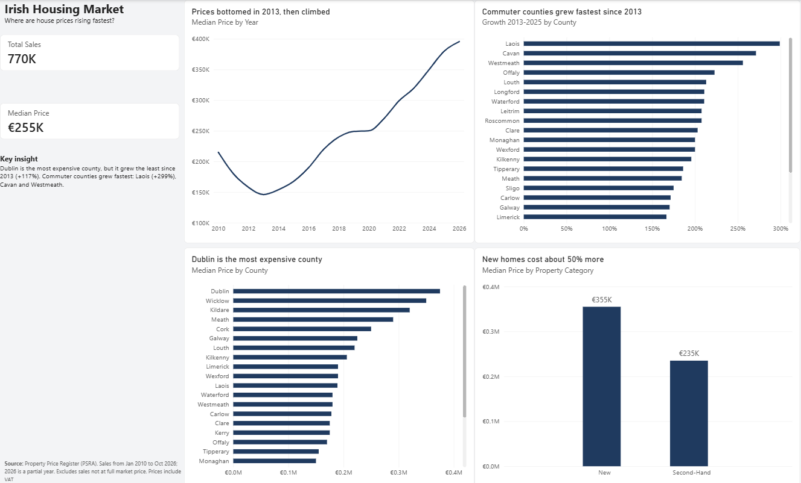

# Irish Housing Market Dashboard

**Where are house prices in Ireland rising, and how fast?**

I built this Power BI dashboard to answer that question for a mortgage team at an Irish bank. It uses about 770,000 house sales from the Property Price Register, from January 2010 to October 2026.

🎥 **Video walkthrough (3 min):** https://youtu.be/csnCwz-VBTs

## Key findings

- **Prices more than doubled.** The median price hit its lowest point in 2013, at around €146K. In 2026 it is around €396K.
- **Dublin is the most expensive county, but it grew the least.** The median in Dublin is around €375K, and prices there grew about 117% from 2013 to 2025.
- **Commuter counties grew fastest.** Laois grew almost 300%, followed by Cavan and Westmeath.
- **New homes cost about 50% more.** The median for a new home is around €355K, and €235K for a second-hand home. Only 1 in 5 sales is a new home.

## What this means for a mortgage team

1. Commuter counties like Laois and Cavan are growing fastest. Those are the areas to watch.
2. Buyers of new homes usually need bigger mortgages.

## How I built it

**Data cleaning in Power Query**
- Removed sales that were not at full market price.
- Added VAT where prices were recorded without it, so all prices are comparable.
- Grouped the property descriptions into New and Second-Hand. Some were written in Irish or had broken text.
- Kept only the columns the analysis needed: sale date, county, price and property category.

**Measures in DAX**
- `Total Sales`, `Median Price`, and `Growth 2013-2025` (median price in 2025 compared with 2013).

I used the median instead of the average, because a few very expensive sales would pull the average up.

## Limitations

- 2026 is a partial year, with data up to October.
- Growth uses 2013 to 2025, so a partial year doesn't distort it.
- This is not a price index. If the mix of homes sold changes, the median changes too.
- I analysed by county, because the addresses in the register are typed by hand and have many typos.

## Tools

Power BI Desktop · Power Query · DAX

## How to open it

Download `irish-property-prices.pbix` and open it in [Power BI Desktop](https://www.microsoft.com/power-platform/products/power-bi/desktop) (free).

## Data source

[Property Price Register](https://www.propertypriceregister.ie), Property Services Regulatory Authority (PSRA). The raw data is not included in this repository. You can download it from the PSRA website.

## Contact

I'm open to Data Analyst and Marketing Analyst roles.
[LinkedIn](https://www.linkedin.com/in/catalinagonzalezgarciadelahuerta)
